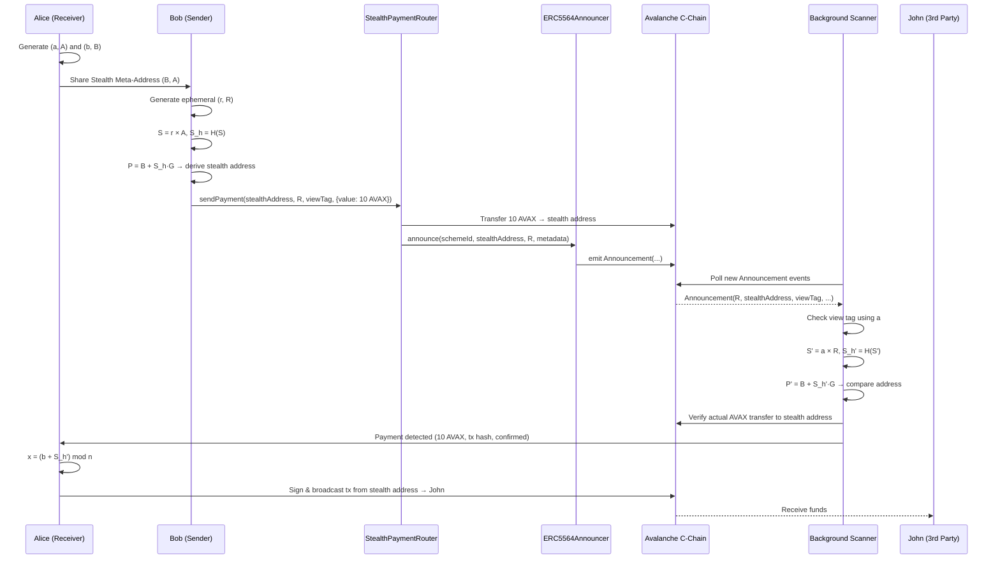
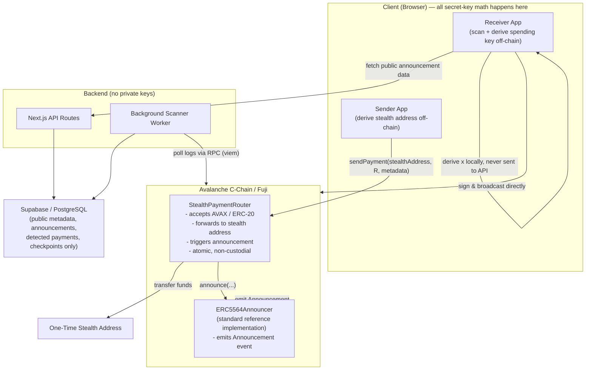
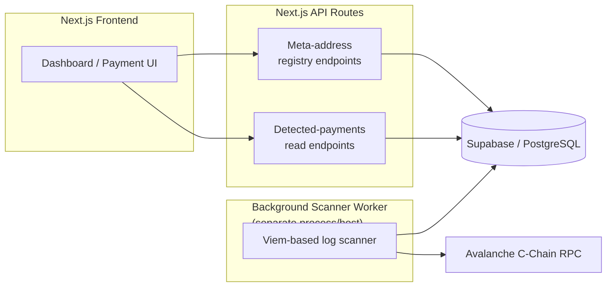

# StealthPay — Project Flow & Technical Blueprint

> **Status of this document:** **Milestones 1–3 are implemented.** The frontend, the ERC-5564 cryptographic engine ([docs/CRYPTO_ENGINE.md](./docs/CRYPTO_ENGINE.md)), the Avalanche smart contracts ([docs/DEPLOYMENT.md](./docs/DEPLOYMENT.md)) and the encrypted key-recovery vault ([docs/KEY_RECOVERY.md](./docs/KEY_RECOVERY.md)) all exist and are tested. **Contracts are not yet deployed** — no funded Fuji deployer key was available. The backend, database and live event scanner remain target architecture.

---

## Table of Contents

1. [Project Overview](#1-project-overview)
2. [Problem Statement](#2-problem-statement)
3. [Project Objectives](#3-project-objectives)
4. [Participants and Their Roles](#4-participants-and-their-roles)
5. [Key Terminology](#5-key-terminology)
6. [Viewing Key and Spending Key](#6-viewing-key-and-spending-key)
7. [Stealth Meta-Address Generation](#7-stealth-meta-address-generation)
8. [Sender-Side Ephemeral Key Generation](#8-sender-side-ephemeral-key-generation)
9. [Shared-Secret Calculation](#9-shared-secret-calculation)
10. [One-Time Address Derivation](#10-one-time-address-derivation)
11. [Payment Execution](#11-payment-execution)
12. [ERC-5564 Announcement](#12-erc-5564-announcement)
13. [Receiver-Side Scanning](#13-receiver-side-scanning)
14. [Payment Detection and Verification](#14-payment-detection-and-verification)
15. [One-Time Private-Key Derivation](#15-one-time-private-key-derivation)
16. [Payment Settlement to a Third Party](#16-payment-settlement-to-a-third-party)
17. [Full Example: Alice, Bob, and John](#17-full-example-atharva-yogesh-and-dhananjay)
18. [Smart Contract Architecture](#18-smart-contract-architecture)
19. [Backend and Database Architecture](#19-backend-and-database-architecture)
20. [Privacy Model](#20-privacy-model)
21. [Security Considerations](#21-security-considerations)
22. [Gas Management](#22-gas-management)
23. [MVP Scope](#23-mvp-scope)
24. [Future Enhancements](#24-future-enhancements)

---

## 1. Project Overview

StealthPay is a privacy-preserving payment application built on the **Avalanche C-Chain**. It lets a receiver accept funds through independently generated, one-time **stealth addresses** instead of a single reusable wallet address, so that public observers cannot trivially link incoming payments to the receiver's primary wallet identity.

StealthPay implements the cryptographic scheme defined by **[ERC-5564: Stealth Addresses](https://ercs.ethereum.org/ERCS/erc-5564)**, using the SECP256k1 curve that underlies the Avalanche C-Chain (an EVM-compatible chain). The project targets **Avalanche Fuji Testnet** for development and demonstration, with **Avalanche C-Chain Mainnet** as the eventual production target.

This document is the technical blueprint. For the public-facing pitch, see [README.md](./README.md). For stack rationale, see [TECH_STACK.md](./TECH_STACK.md).

## 2. Problem Statement

Public blockchains are transparent by design. Once a wallet address is shared to receive payment, anyone can observe:

- Every incoming transaction to that address.
- The full transaction history and running balance.
- Patterns that reveal counterparties and payment relationships.
- Financial activity over time, even if the wallet owner never discloses their real-world identity.

Reusing the same address for multiple payments compounds this: it lets outside observers cluster activity and build a financial profile of the holder. This is a genuine problem for freelancers, businesses, traders, and any individual who wants to receive crypto without broadcasting their financial life.

StealthPay does not try to hide the payment itself (amount, sender, timing are still public). It solves a narrower, well-defined problem: **preventing the one-time receiving address from being linkable to the receiver's persistent wallet identity.**

## 3. Project Objectives

- Let a receiver generate a reusable **Stealth Meta-Address** that can be shared publicly (QR code, link, string) without exposing their primary wallet.
- Let a sender derive a fresh, unique, one-time stealth address for every payment using only the receiver's public stealth meta-address.
- Publish the information the receiver needs to find their payment (the ERC-5564 **Announcement**) without revealing which announcement belongs to which receiver to anyone but the receiver.
- Let the receiver scan the chain, detect payments addressed to them, and recover spending control of those one-time addresses using only locally-held private keys.
- Demonstrate the entire flow as a real, working, on-chain interaction on Avalanche Fuji, with a clear, honest description of what privacy guarantee is and isn't provided.

## 4. Participants and Their Roles

StealthPay's flow is explained throughout this documentation using one running example:

| Role | Example Person | Responsibility |
|---|---|---|
| **Receiver** | Alice | Generates a stealth identity (viewing + spending key pairs), publishes a Stealth Meta-Address, scans the chain for payments, recovers and spends funds from detected one-time addresses. |
| **Sender** | Bob | Obtains the receiver's Stealth Meta-Address, generates a fresh ephemeral key per payment, derives the one-time stealth address, and sends funds to it. |
| **Third-Party Recipient** | John | Receives funds forwarded by the receiver from a detected stealth payment. Has no special role in the protocol — just a normal wallet address. |

Bob sends 10 AVAX to Alice without ever touching Alice's primary wallet address. Alice later forwards those funds to John, again without exposing their primary wallet.

## 5. Key Terminology

| Term | Meaning |
|---|---|
| **Viewing Key Pair** `(a, A)` | Private/public key pair used only to *detect* incoming payments. |
| **Spending Key Pair** `(b, B)` | Private/public key pair used to *recover control* of one-time addresses. |
| **Stealth Meta-Address** | The receiver's two public keys, `(B, A)`, published and shared with senders. |
| **Ephemeral Key Pair** `(r, R)` | A fresh, single-use key pair generated by the **sender** for each payment. |
| **Shared Secret** `S` | An ECDH-derived point computed independently by sender and receiver; identical for both. |
| **View Tag** | A short byte derived from the hashed shared secret, used to cheaply filter irrelevant announcements before doing full elliptic-curve math. |
| **Stealth Address** | The one-time, EVM-compatible address derived for a specific payment. Controlled only by the intended receiver. |
| **Announcement** | An on-chain event (per ERC-5564) that publishes the ephemeral public key and metadata needed for receivers to scan for payments. |
| **Scheme ID** | An ERC-5564 identifier for which cryptographic curve/hash scheme was used (StealthPay uses the SECP256k1 scheme). |

## 6. Viewing Key and Spending Key

Every receiver in StealthPay controls **two independent key pairs**, generated client-side and never transmitted to any backend.

### Viewing Key Pair

```
Private Viewing Key = a
Public Viewing Key  = A = a × G
```

- `a` lets the receiver detect incoming payments by computing shared secrets against every announcement's ephemeral public key.
- `A` is published as part of the Stealth Meta-Address.
- Critically, **scanning for payments requires only `a`**, not the spending key. This means a "view-only" mode is architecturally possible (e.g. a watch-only scanner that can see payments but cannot move funds), though it is not required for the MVP.

### Spending Key Pair

```
Private Spending Key = b
Public Spending Key  = B = b × G
```

- `b` lets the receiver derive the actual private key controlling each one-time stealth address, once a payment is detected.
- `B` is published as part of the Stealth Meta-Address.

Both pairs use the **SECP256k1** curve — the same curve used by Ethereum/Avalanche account keys — so `G` is the standard SECP256k1 base point and all derived addresses remain fully EVM-compatible.

## 7. Stealth Meta-Address Generation

The receiver combines only the two **public** keys:

```
Stealth Meta-Address = (B, A)
```

This is the only information the receiver ever needs to share to receive private payments. It can be distributed as:

- A QR code.
- A copyable encoded string (following the ERC-5564 / ERC-6538 convention, e.g. `st:avax:0x<B><A>`, with `B` listed before `A` per the standard's canonical example URI and SECP256k1 public-key ordering).
- A payment link inside the StealthPay app.

**The two private keys (`a`, `b`) never leave the receiver's device.** They are not sent to Bob, not sent to the StealthPay backend, and not stored in Supabase.

## 8. Sender-Side Ephemeral Key Generation

This is a deliberate and important architectural property of the scheme: **the sender generates the ephemeral key, not the receiver.**

Before sending a payment, Bob's client generates:

```
r = a new, cryptographically random private scalar   (ephemeral private key)
R = r × G                                             (ephemeral public key)
```

Rules that must hold:

- `r` and `R` must be freshly generated for **every single payment**. Reusing an ephemeral key across payments breaks the unlinkability guarantee for all payments that share it.
- `r` must never be published, logged, stored, or transmitted anywhere. Only `R` is published (as part of the Announcement).
- `r` must be generated with a secure, cryptographically strong random source (never `Math.random()` or similar).

## 9. Shared-Secret Calculation

Bob's client computes an ECDH shared secret using Alice's **public** viewing key and their own freshly generated ephemeral private key:

```
S  = r × A
Sₕ = H(S)
```

Where `H` is the hash function defined by the **ERC-5564 SECP256k1 scheme** (scheme ID for SECP256k1), applied to the canonical serialized encoding of the elliptic-curve point `S` (per the reference implementation — typically the compressed SEC1 byte encoding, hashed with Keccak-256, with the result reduced to a valid scalar mod the curve order `n`). The **view tag** used for fast filtering is derived from a defined byte of this same hash.

> ✅ **Verified and pinned.** `H` is **keccak-256** applied to the **33-byte SEC1 compressed** encoding of the shared-secret point, and the resulting 32-byte hash is used **directly as a scalar** with no mod-`n` reduction. The **view tag is its most-significant byte**. These were read out of `@scopelift/stealth-address-sdk@1.0.0-beta.5` and are asserted in `src/lib/stealth/__tests__/interop.test.ts`, so a dependency upgrade that changes them fails the suite. It is **not** SHA-256. Full detail: [docs/CRYPTO_ENGINE.md](./docs/CRYPTO_ENGINE.md).

## 10. One-Time Address Derivation

Using the hashed shared secret, Bob derives a one-time **stealth public key**:

```
P = B + (Sₕ × G)
```

`P` is converted into a standard Ethereum-compatible address using the normal EVM address derivation:

1. Take the uncompressed SECP256k1 public key encoding of `P`.
2. Hash it with Keccak-256.
3. Take the last 20 bytes of the hash.
4. Apply standard EIP-55 checksum formatting.

The result is the **one-time stealth address** — a normal-looking EVM address that Bob sends funds to. Nothing about this address reveals, on its own, that it is connected to Alice.

## 11. Payment Execution

Bob's client (the StealthPay frontend):

1. Resolves Alice's Stealth Meta-Address `(B, A)`.
2. Generates `(r, R)` and computes the stealth address as above.
3. Shows Bob the derived stealth address and payment details (asset, amount) for confirmation **before** anything is broadcast.
4. Calls the `StealthPaymentRouter` contract (see [§18](#18-smart-contract-architecture)) to atomically transfer funds to the stealth address **and** emit the required ERC-5564 Announcement in a single transaction.

## 12. ERC-5564 Announcement

The on-chain `Announcement` event (defined by ERC-5564) is what makes the payment discoverable, without revealing to anyone but Alice which specific announcement belongs to them. It carries:

| Field | Description |
|---|---|
| `schemeId` | Identifies the SECP256k1 stealth-address scheme in use. |
| `stealthAddress` | The one-time address funds were sent to. |
| `caller` | The address that triggered the announcement (the router contract, or Bob's address depending on design). |
| `ephemeralPubKey` | `R`, the sender's one-time ephemeral public key — required by every receiver scanning the chain to test for a match. |
| `metadata` | Includes the **view tag** byte and, for token payments, the token contract address, function selector, and amount. |

The payment transfer and the announcement should occur **atomically**, ideally inside the same `StealthPaymentRouter` transaction, so there is never an announcement without a matching transfer, or a transfer without its announcement.

## 13. Receiver-Side Scanning

Alice's StealthPay client (or a protected background scanner acting on their behalf, see [§19](#19-backend-and-database-architecture)) continuously watches the Avalanche C-Chain for new `Announcement` events, in paginated block ranges, tracking a checkpoint of the last block scanned.

For each announcement:

1. Cheaply check the **view tag** first — if it doesn't match what Alice's viewing key would produce for this `R`, skip immediately without doing the more expensive elliptic-curve math.
2. For announcements that pass the view-tag filter, compute the full shared secret (see [§14](#14-payment-detection-and-verification)).

## 14. Payment Detection and Verification

Alice's client uses their **private viewing key** `a` and the announced ephemeral public key `R` to independently compute the same shared secret Bob computed:

```
S'  = a × R
Sₕ' = H(S')
```

This works because of the Elliptic Curve Diffie-Hellman (ECDH) identity:

```
a × R = a × (r × G) = r × (a × G) = r × A
```

Both sides land on the identical point, so `S' = S` and therefore `Sₕ' = Sₕ`.

Alice then re-derives the candidate stealth public key and address:

```
P' = B + (Sₕ' × G)
```

If the address derived from `P'` matches the `stealthAddress` published in the announcement, Alice has found a payment addressed to them.

**This match alone is not sufficient.** The scanner must then independently verify that an actual asset transfer (native AVAX balance change, or an ERC-20 `Transfer` event) occurred to that stealth address, matching the claimed amount and asset. **An announcement is a claim, not proof — it must never be treated as evidence that funds were actually received**, since nothing on-chain enforces that an announcement is accompanied by a real transfer unless it flows through a router contract designed to make them atomic.

## 15. One-Time Private-Key Derivation

Once Alice has confirmed both the address match and the underlying transfer, they can derive the private key that controls the one-time stealth account — entirely client-side:

```
x = (b + Sₕ') mod n
```

Where:
- `b` = Alice's private spending key.
- `Sₕ'` = the shared-secret hash computed in [§14](#14-payment-detection-and-verification).
- `n` = the SECP256k1 curve order.
- `x` = the private key controlling the one-time stealth address.

This key is held only in memory on Alice's device for the duration of the signing operation. **It must never be sent to a backend API, logged, or persisted in plaintext in Supabase or anywhere else.**

## 16. Payment Settlement to a Third Party

Alice can now use `x` to sign a standard transaction directly from the one-time stealth account:

1. Alice opens the detected payment in their StealthPay dashboard and selects **Send**.
2. They enter John's ordinary wallet address and an amount.
3. StealthPay derives `x` locally (per [§15](#15-one-time-private-key-derivation)) and builds the transaction.
4. Alice signs and broadcasts it — funds move directly from the one-time stealth address to John.

Alice's primary wallet never appears as sender or receiver in either leg of the payment.

## 17. Full Example: Alice, Bob, and John

### Stage 1 — Alice generates their stealth identity
Alice's client generates `(a, A)` and `(b, B)` locally, derives their Stealth Meta-Address `(B, A)`, and shares it with Bob (QR code / link / string).

### Stage 2 — Bob initiates payment
Bob's client resolves Alice's meta-address, generates a fresh `(r, R)`, computes the shared secret, and derives the one-time stealth address. Bob reviews the derived address and payment details before confirming.

### Stage 3 — Payment on Avalanche
Bob sends 10 AVAX through the `StealthPaymentRouter`. The router forwards the AVAX to the stealth address and atomically emits an `Announcement` containing the scheme ID, stealth address, caller, `R`, and metadata (view tag + asset info).

### Stage 4 — Alice detects the payment
Alice's scanner (or client-side scan) picks up the announcement, matches the view tag, computes `S'`/`Sₕ'`, confirms the derived address matches, and verifies the actual AVAX transfer on-chain. The payment appears in Alice's dashboard: asset (AVAX), amount (10), stealth address, transaction hash, confirmation status.

### Stage 5 — Alice spends the funds
Alice selects the detected payment, chooses **Send**, enters John's address, and StealthPay derives `x` client-side, builds, signs, and broadcasts the transaction.

### Stage 6 — Payment settlement
The public chain now shows two transactions:

```
Bob → One-Time Stealth Address
One-Time Stealth Address → John
```

Alice's primary wallet address appears in neither. The transaction graph itself is fully public — anyone can see both legs and the amounts — but the cryptographic link between the stealth address and Alice's reusable identity is not directly disclosed on-chain.

> **This provides recipient identity unlinkability — not complete transaction anonymity.** See [§20](#20-privacy-model).

### Diagram — End-to-End Payment Sequence



## 18. Smart Contract Architecture

StealthPay's on-chain layer is intentionally thin. **All private-key cryptography happens off-chain, client-side.** Contracts only move funds and publish public announcement data.



### `ERC5564Announcer`

- Use the **official ERC-5564 reference Announcer implementation** wherever possible, rather than writing a custom one, to maximize interoperability with other ERC-5564 tooling.
- The ERC-5564 spec references a deterministic cross-chain address (`0x55649E01B5Df198D18D95b5cc5051630cfD45564`) used on networks where it has been deployed via a deterministic deployer. **This must not be assumed to exist on Fuji or Avalanche C-Chain without direct verification.** If it is not already deployed there, the team must deploy the official, unmodified reference bytecode to Fuji itself as part of the project's own deployment step, and record the resulting address in [README.md](./README.md#smart-contract-deployment-instructions).

### `StealthPaymentRouter` (custom, to be built)

Responsibilities:
- Accept native AVAX payments and forward them to the derived stealth address.
- Accept ERC-20 token payments via a safe `transferFrom` flow with correct allowance handling.
- Call the configured `ERC5564Announcer` to emit the Announcement **in the same transaction** as the transfer, so a payment and its announcement can never exist independently of each other.
- Include the correct `ephemeralPubKey` and view-tag metadata in the announcement call.
- **Not custody funds** beyond the atomic forwarding transaction — it is a pass-through, not a vault.

**Explicit non-goal:** no private-key cryptography (ephemeral key generation, shared-secret computation, address derivation) happens in Solidity. The contract receives already-derived public data (`stealthAddress`, `R`, metadata) from the client and simply moves funds and emits the event.

## 19. Backend and Database Architecture



The backend's role is deliberately limited to handling **public** information:

- **Published stealth meta-addresses** (optional registry, mirroring ERC-6538-style lookup, so a sender can resolve a receiver's meta-address by a human-readable handle rather than copy-pasting raw keys).
- **Raw Announcement data** read from the chain (ephemeral public keys, view tags, stealth addresses, tx hashes) — all of this is already public on-chain; storing it is a performance/UX optimization, not a secrecy boundary.
- **Detected-payment records** for a receiver's dashboard (asset, amount, stealth address, tx hash, confirmation status) — written by the scanner once a transfer has been verified.
- **Scanner checkpoints** (last scanned block per chain) to support resumable, incremental scanning.

**Hard rule:** the database **never** stores a viewing private key, spending private key, or any derived one-time stealth private key, in plaintext or otherwise. See [§21](#21-security-considerations) and the scanner design note below.

### Scanner design tension (needs a product decision)

Computing `S' = a × R` for every announcement requires the viewing private key `a`. There are two honest architectural options, and the MVP needs to pick one explicitly:

1. **Client-side scanning**: the receiver's browser/app periodically fetches raw announcement data from the backend (public data only) and performs all `a`-dependent math locally. Simplest from a trust standpoint — the viewing key never leaves the device — but requires the receiver's client to be online/active to scan, or to re-scan a backlog on each visit.
2. **Protected server-side scanning**: a background worker holds a receiver's viewing key (not the spending key) in a deliberately isolated, encrypted, access-controlled environment to scan continuously on their behalf. This improves UX (payments appear even when the receiver is offline) but introduces a key-custody component that must be designed and audited carefully — it should never be a routine, unauthenticated backend API.

This document does not assume one is "done" — it is flagged in [§21](#21-security-considerations) and the final summary as an open decision the team must make deliberately before writing scanner code.

## 19a. Implemented Cryptographic API (Milestone 2)

The flow in §6–§16 is implemented in [`src/lib/stealth/`](./src/lib/stealth/).
Mapping from this document's notation to the shipped functions:

| This document | Function | Returns |
|---|---|---|
| §6–§7 generate `(a, A)`, `(b, B)`, meta-address | `generateStealthIdentity(chainId)` | `publicIdentity` + `secrets` (separated) |
| §7 parse `(B, A)` | `parseStealthMetaAddress(uri)` | validated compressed keys + chain label |
| §8–§10 `r`, `R`, `S`, `P` | `generateOneTimeStealthAddress({ metaAddress, chainId })` | `stealthAddress`, `ephemeralPublicKey`, `viewTag`, `schemeId` |
| §13–§14 detect | `checkStealthAnnouncement({ ... })` | `{ isForUser, reason, derivedStealthAddress }` |
| §15 `x = (b + S_h') mod n` | `deriveOneTimeSpendingKey({ ... })` | verified `SecretKeyMaterial` + address |

Key formats: private scalars are 32 bytes; all public keys are 33-byte SEC1
compressed (`0x` + 66 hex chars); the meta-address body is `0x` + 132 hex chars
with the **spending key first**; the view tag is `0x` + 2 hex chars.

Two behaviours worth noting against §8 and §14:

- The ephemeral private key `r` is **never returned** by the public sender API,
  so it cannot reach the UI. A fresh one is generated per derivation.
- `deriveOneTimeSpendingKey` re-derives the address from the recovered scalar
  and **rejects on mismatch**, so §15's output is always verified before use.

The scanning architecture question raised in §19 is still open; the engine runs
client-side today, and nothing holds a viewing key server-side.

## 19b. Implemented Contract Layer (Milestone 3)

Contracts live in [`contracts/`](./contracts/) as a separate npm project, so
Hardhat never enters the Next.js build.

### ERC5564Announcer
The ERC-5564 reference Announcer: no state, no funds, no privileges. Its event
is byte-identical to the canonical deployment —
`topic0 0x5f0eab80…f4e7`, selector `0x4d1f9583` — both verified against the
contract live at the canonical address on Avalanche **mainnet**.

**The canonical address has no code on Fuji** (`eth_getCode` → `0x`), and the
ERC publishes neither the init code nor the salt behind it, so that address
cannot be reproduced. StealthPay deploys the reference implementation instead
and records the real address. The script reuses the canonical singleton
automatically if it ever appears.

### StealthPaymentRouter
Moves the payment and publishes the announcement **in one transaction**.

| Function | Behaviour |
|---|---|
| `payNative(stealthAddress, ephemeralPubKey, viewTag)` | Forwards the full `msg.value`, then announces. |
| `payERC20(token, stealthAddress, amount, ephemeralPubKey, viewTag)` | Pulls tokens payer → stealth address via `safeTransferFrom`, announces, then forwards any `msg.value` as a gas top-up and announces that separately. |

Properties: immutable Announcer; `SCHEME_ID = 1` as a constant (not a
parameter, so no unsupported scheme can be announced); no owner/pause/upgrade/
withdraw; no `receive`/`fallback`, so AVAX cannot enter except through the
payment functions; `ReentrancyGuard`; exact-amount delta check that rejects
fee-on-transfer and rebasing tokens.

### Announcement metadata
Both layouts are 57 bytes and **byte 0 is always the view tag**:

```
native : viewTag(1) ‖ 0xeeeeeeee(4) ‖ 0xEeee…EEeE(20) ‖ amount(32)
ERC-20 : viewTag(1) ‖ 0x23b872dd(4) ‖ token(20)        ‖ amount(32)
```

`0x23b872dd` is `transferFrom`, the operation the router actually performs.

### `caller` is the router, not the payer
The Announcer records `msg.sender`. When the router announces, that is the
**router**. Scanners must not read `caller` as the payer; the payer is already
visible as the transaction's `from`.

### Gas funding (§22 resolved for the sender-funded case)
`payERC20` accepts an optional `msg.value`, forwarded to the same stealth
address and announced separately — two parseable announcements for one
destination. Sender-funded deliberately: topping up later from the receiver's
own wallet would recreate the link stealth addresses exist to break. Without a
top-up the token payment still succeeds, but the destination cannot spend until
it has AVAX, and the UI says so.

## 19c. Implemented Key Recovery (Milestone 3)

§19's volatile-identity problem is resolved. The same ERC-5564 scalars are
encrypted with **Argon2id** (19 MiB, t=2, p=1 — OWASP minimum) into
**AES-256-GCM**, with the format version and KDF parameters bound as AAD so a
work-factor downgrade fails the tag check. Only ciphertext is persisted, in
IndexedDB. A `.stealthpay` file enables cross-device restore; restoring
recomputes the public keys from the private scalars and rebuilds the
meta-address, rejecting any mismatch rather than partially restoring.

A refresh now **locks** the identity instead of destroying it. There is no
password reset: lose both the file and the password and the identity is gone.
Full threat model in [docs/KEY_RECOVERY.md](./docs/KEY_RECOVERY.md).

## 20. Privacy Model

StealthPay provides **recipient identity unlinkability**, not transaction anonymity. Be precise about what is and isn't hidden:

| Hidden / Unlinkable | Still Publicly Visible |
|---|---|
| The cryptographic link between a one-time stealth address and the receiver's primary wallet identity | The sender's address |
| Which of the receiver's many payments belong to the same person, *to an outside observer without the viewing key* | The stealth (destination) address itself |
| The receiver's reusable wallet being directly named as the counterparty | The transaction amount |
| | Transaction timing |
| | The subsequent transaction(s) when funds are forwarded onward (e.g. stealth address → John) |
| | The overall transaction graph (it is simply not labeled with the receiver's primary identity) |

StealthPay explicitly does **not** provide:
- Transaction mixing or CoinJoin-style amount/sender obfuscation.
- Confidential balances or confidential transaction amounts.
- Zero-knowledge transaction privacy.
- Sender anonymity.
- Protection against sophisticated timing/amount correlation analysis across the two legs of a forwarded payment.

Any public communication about StealthPay (README, pitch deck, demo narration) must preserve this distinction and avoid language implying full anonymity.

## 21. Security Considerations

1. All private keys (viewing, spending, ephemeral, derived one-time) must be generated using a cryptographically secure random source.
2. A fresh ephemeral key pair `(r, R)` is required for **every** payment; ephemeral key reuse across payments must be actively prevented in the sender's client.
3. Ephemeral private keys (`r`) must never be published, logged, or persisted anywhere, including in application logs or crash reports.
4. Receiver private keys (`a`, `b`) must never be transmitted to the sender, to the backend, or to any third party.
5. No private key of any kind (viewing, spending, ephemeral, or derived one-time) may be logged in plaintext.
6. No private key of any kind may be submitted to an ordinary, unauthenticated backend API endpoint.
7. One-time spending-key derivation (`x = b + Sₕ' mod n`) must happen in a protected client-side environment; this is a hard client-side-only operation, not something the backend performs on the receiver's behalf.
8. All elliptic-curve points and private scalars received or computed must be validated (on-curve checks, non-zero/non-identity checks, correct range relative to the curve order `n`) before use.
9. The system must actively guard against ephemeral key reuse (e.g. detect/warn if an `R` value repeats).
10. Every detected payment must be verified against an actual on-chain asset transfer — an `Announcement` event is a claim, not proof.
11. An announcement must never, by itself, be treated as evidence that a payment was received (see [§14](#14-payment-detection-and-verification)).
12. The scanner must be resilient to replayed/duplicate events, out-of-order delivery, and chain reorganizations (tracked via block hash + tx hash, not just block number).
13. All documentation and product communication must avoid overstating the privacy guarantee — see [§20](#20-privacy-model).
14. Gas funding for one-time stealth accounts must be designed so it does not itself create a traceable link back to the receiver's primary wallet — see [§22](#22-gas-management).

## 22. Gas Management

This is a real, non-trivial design problem that must be addressed explicitly rather than assumed away.

**The core issue:** a one-time stealth address can hold an asset (e.g. an ERC-20 token) but have **zero native AVAX**. On Avalanche C-Chain, every transaction — including an ERC-20 `transfer` — requires native AVAX to pay gas. A stealth address with tokens but no AVAX is **stuck**: it cannot sign and broadcast any transaction to move those tokens out.

For native-AVAX-only payments (the MVP), this problem mostly disappears, because the payment itself deposits native AVAX into the stealth address, which can then be used directly to pay gas for the onward transfer to John (minus the gas cost itself).

For ERC-20 payments (a planned extension beyond MVP), the stealth address needs a small amount of native AVAX from somewhere before it can move the tokens. Candidate approaches, to be evaluated rather than assumed:

| Approach | How it works | Trade-off |
|---|---|---|
| **Sender-provided gas top-up** | The `StealthPaymentRouter` sends a small amount of native AVAX to the stealth address alongside the token transfer, funded by the sender. | Simple, no new infrastructure; slightly increases sender's cost per payment; still originates from the sender, not the receiver, so it does not reveal the receiver's primary wallet. |
| **Transaction sponsorship / meta-transactions** | A relayer or paymaster-style contract covers gas on the receiver's behalf when they spend from the stealth address, reimbursed from the transferred tokens. | Better UX (receiver never needs AVAX at all); requires a relayer component and careful anti-abuse design; adds trust/availability dependency on the relayer. |
| **Relayer-based system (future enhancement)** | A dedicated relayer service accepts a signed "spend" intent from the receiver and submits the transaction, paying gas itself. | Most flexible long-term answer; explicitly out of scope for MVP; needs its own security review before being built. |

**Important constraint on all of the above:** whatever funding mechanism is chosen must not casually route every stealth account's gas top-up *from the receiver's own primary wallet*, since that would recreate exactly the linkability problem StealthPay exists to prevent. Gas funding should come from the sender-side flow (preferred for MVP) or from a relayer that is not tied 1:1 to the receiver's identity.

## 23. MVP Scope

**In scope for MVP:**
- Native AVAX payments only.
- ERC-5564 SECP256k1 stealth address generation, fully client-side.
- `StealthPaymentRouter` + `ERC5564Announcer` deployed and verified on Avalanche Fuji.
- Receiver dashboard showing detected AVAX payments (asset, amount, stealth address, tx hash, status).
- Manual "Send to third party" flow from a detected stealth address.
- A scanner (client-side or an explicitly protected worker — see [§19](#19-backend-and-database-architecture)) with resumable checkpointing.
- Clear, correct documentation of the privacy model (no overstated claims).

**Explicitly out of scope for MVP** (see [§24](#24-future-enhancements)):
- ERC-20 token payments and their associated gas-funding mechanism.
- Relayer/meta-transaction infrastructure.
- Mainnet deployment.
- Any ZK, mixing, or confidential-balance features.
- Avalanche-specific extras such as eERC, ICM, or ICTT (optional, not required for this problem).

## 24. Future Enhancements

- ERC-20 token support on Fuji and Mainnet, including the gas-funding mechanism chosen from [§22](#22-gas-management).
- A relayer-based gas sponsorship system for stealth-account spending.
- An on-chain or ERC-6538-style registry contract for publishing stealth meta-addresses by handle, rather than relying solely on the Supabase-backed registry.
- A protected, audited server-side scanning mode (as an alternative/complement to client-side scanning) for always-on payment detection.
- Mainnet C-Chain deployment once Fuji testing and a security review are complete.
- Optional support for additional EVM chains, if there is a compelling product reason — not pursued merely to inflate scope.
