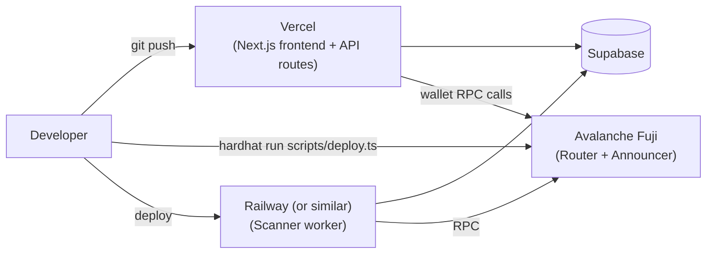

# StealthPay — Technology Stack

> This document describes the StealthPay stack. The **frontend (M1)**, **cryptographic engine (M2)**, **smart contracts (M3)** and **encrypted key recovery (M3)** are implemented, and their versions below are the ones actually installed. Contracts are **built and locally tested but not yet deployed**. The backend, database and scanner remain **planned**. See [docs/DEPLOYMENT.md](./docs/DEPLOYMENT.md) and [docs/KEY_RECOVERY.md](./docs/KEY_RECOVERY.md).

---

## 1. Stack Summary Table

| Category | Technology | Purpose | MVP / Supporting / Optional |
|---|---|---|---|
| Blockchain network | Avalanche C-Chain + Fuji Testnet | Execution environment for all contracts and payments | **MVP** |
| Smart contract language | Solidity 0.8.28 (`evmVersion: cancun`) | `StealthPaymentRouter` + `ERC5564Announcer` | **Implemented, not deployed** |
| Contract tooling | Hardhat 2.29.1 + toolbox 5 (ethers v6, chai matchers) | Compile, test, deploy; precise event-log assertions | **Implemented** |
| Contract libraries | OpenZeppelin Contracts 5.6.1 | `SafeERC20`, `ReentrancyGuard` | **Implemented** |
| Stealth address standard | ERC-5564 | Defines the announcement interface and SECP256k1 derivation scheme | **MVP** |
| Frontend framework | Next.js (React, TypeScript) | Sender + receiver UI, API routes | **MVP** |
| Styling | Tailwind CSS + shadcn/ui | Dashboard and payment interfaces | **MVP** |
| Wallet connection | Wagmi + Viem | Wallet connection, contract calls, log/event reads | **MVP** |
| Wallets supported | MetaMask, Core Wallet | End-user signing | **MVP** |
| Cryptography | `@scopelift/stealth-address-sdk` 1.0.0-beta.5 (pinned) | ERC-5564 scheme 1 reference implementation | **Implemented** |
| Cryptography | `@noble/secp256k1` 2.3.0 | SECP256k1 scalars, points, ECDH, CSPRNG key generation | **Implemented** |
| Address derivation | `viem` 2.x (`publicKeyToAddress`, `keccak256`) | Canonical EVM address derivation and EIP-55 checksums | **Implemented** |
| Backend runtime | Node.js + TypeScript | API routes, scanner worker | **MVP** |
| Scanner | Standalone worker using Viem | Reads Announcement events, detects payments | **MVP** |
| Key derivation | Argon2id via `hash-wasm` 4.12 (19 MiB / t=2 / p=1) | Derives the vault AES key from the password | **Implemented** |
| Vault encryption | AES-256-GCM via Web Crypto `SubtleCrypto` | Encrypts the identity at rest, AAD-bound | **Implemented** |
| Local secret storage | IndexedDB via `idb` 8 | Stores ONLY the ciphertext envelope | **Implemented** |
| Backup format | `STEALTHPAY_ENCRYPTED_BACKUP` v1, `.stealthpay` | Versioned encrypted off-device backup | **Implemented** |
| Database | Supabase (PostgreSQL) | Public metadata, announcements, detected payments, checkpoints | Planned |
| Frontend hosting | Vercel | Hosts the Next.js app | **MVP** |
| Scanner hosting | Railway (or similar) | Hosts the long-running scanner worker | Supporting |
| Testing (contracts) | Hardhat test suite | Contract correctness | **MVP** |
| Testing (app/crypto) | Vitest 5 | 53 tests across 7 files covering the crypto engine | **Implemented** |
| Wallet-connect UI | RainbowKit (or equivalent) | Polished multi-wallet connect modal | Supporting |
| Relayer / meta-transactions | _Not yet selected_ | Gas sponsorship for ERC-20 stealth spends | Optional / Future |
| eERC, ICM, ICTT | Avalanche-specific primitives | N/A to this problem | **Not used** — intentionally out of scope |

---

## 2–6. Category Deep Dive: Technology, Purpose, Suitability, Interaction

### 2.1 Blockchain: Avalanche C-Chain + Fuji Testnet

- **Purpose:** the execution and settlement layer for all payments, announcements, and contract logic.
- **Why suitable:** the C-Chain is a fully EVM-compatible chain, so the entire Solidity/Hardhat/Wagmi/Viem ecosystem works unmodified, while giving StealthPay genuine, demonstrable Avalanche integration rather than a superficial label.
- **Interaction:** every other layer — contracts, frontend wallet calls, the scanner's RPC reads — ultimately targets this chain. Fuji is the default network everywhere in configuration; Mainnet is a future target only.

### 2.2 Solidity + Hardhat + OpenZeppelin

- **Purpose:** implement, test, and deploy the two on-chain contracts (`StealthPaymentRouter`, and the `ERC5564Announcer` if not already present on Fuji).
- **Why suitable:** Solidity is the native language of the EVM target; Hardhat is the de facto standard toolchain for compiling, testing (with a local EVM), and scripting deployments to Fuji/Mainnet; OpenZeppelin provides audited primitives (e.g. `SafeERC20` for the router's token transfer path) so the team isn't hand-rolling security-sensitive token-handling code.
- **Interaction:** Hardhat scripts deploy compiled contracts to Fuji; the frontend and scanner then reference the resulting addresses via Viem.

### 2.3 ERC-5564 (Stealth Addresses)

- **Purpose:** defines (a) the SECP256k1 key-derivation scheme that makes stealth addresses interoperable, and (b) the standard `Announcement` event interface that lets any compliant scanner find relevant payments.
- **Why suitable:** rather than inventing a bespoke stealth-address scheme, building on ERC-5564 means StealthPay is compatible with the broader stealth-address tooling ecosystem (reference announcer contracts, other wallets/scanners that implement the same standard) and its cryptography has had public scrutiny that a from-scratch design would lack.
- **Interaction:** the client-side crypto package implements ERC-5564's SECP256k1 scheme for key derivation; the `ERC5564Announcer` contract implements its on-chain event interface; the scanner consumes events in exactly the shape the standard defines.

### 2.4 Next.js, React, TypeScript, Tailwind CSS, shadcn/ui

- **Purpose:** the receiver dashboard and sender payment flow, plus lightweight backend API routes for public metadata.
- **Why suitable:** Next.js gives both a React frontend and colocated API routes in one framework, which keeps the MVP's backend footprint small; TypeScript gives type safety across the cryptography-heavy client code, where a wrong byte length or point encoding is a real correctness risk; Tailwind + shadcn/ui give a fast path to a clean, responsive dashboard without hand-building a design system.
- **Interaction:** the frontend calls Wagmi/Viem to talk to wallets and contracts directly from the browser, and calls its own Next.js API routes to read public metadata (announcements, detected payments) from Supabase.

### 2.5 Wagmi + Viem + MetaMask + Core Wallet

- **Purpose:** wallet connection, contract reads/writes, and chain log queries.
- **Why suitable:** Wagmi provides React hooks for wallet connection and contract interaction; Viem (which Wagmi is built on) provides a modern, typed, lightweight interface for RPC calls, including the `getLogs`-style queries the scanner needs for `Announcement` events. MetaMask and Core Wallet (Avalanche's own wallet) cover the two most relevant wallets for an Avalanche-focused audience, including judges and testers.
- **Interaction:** the frontend uses Wagmi hooks for all wallet/contract interaction; the standalone scanner worker uses Viem directly (without the React-specific Wagmi layer) to poll RPC logs.

### 2.6 Cryptography — IMPLEMENTED

- **Selected:** `@scopelift/stealth-address-sdk@1.0.0-beta.5` (pinned) as the ERC-5564 scheme 1 reference implementation, `@noble/secp256k1@2.3.0` for curve operations and CSPRNG key generation, and `viem` for canonical EVM address derivation.
- **Purpose:** client-side generation of viewing/spending/ephemeral key pairs, ECDH shared-secret computation, and one-time address/key derivation.
- **Why suitable:** using the SDK means the scheme's byte-level conventions come from a published reference rather than a local reinterpretation. `@noble/secp256k1` (the SDK's own curve dependency) is dependency-light and widely used in Ethereum tooling. viem's `publicKeyToAddress` is the same helper the SDK uses, so sender and receiver cannot diverge on address formatting.
- **Interaction:** used exclusively client-side for all private-key operations. None of it runs in the backend or in Solidity. The UI imports only `src/lib/stealth`, never the SDK directly.
- ✅ **Verified, not assumed.** The conventions were read out of the SDK source and then asserted in tests: the ECDH output is the **33-byte compressed** point, the hash is **keccak-256** over those bytes, the 32-byte result is used **directly as a scalar**, and the view tag is its **most-significant byte**. `src/lib/stealth/__tests__/interop.test.ts` fails if a dependency upgrade changes any of this.
- ⚠️ **Beta dependency.** The SDK is pre-1.0 and pinned exactly. Known quirks (directory imports that break Node ESM, an unvalidated chain segment, silent fallback on an invalid ephemeral key, tolerance of single-key meta-addresses) are documented with our handling in [docs/CRYPTO_ENGINE.md §5](./docs/CRYPTO_ENGINE.md).
- ❗ **Not audited.** Tests and an internal round-trip proof are not a security review.

### 2.7 Node.js + TypeScript backend, standalone scanner worker

- **Purpose:** serve public metadata via Next.js API routes, and run a long-lived process that continuously watches the chain for new announcements.
- **Why suitable:** keeping the scanner as a separate process (rather than inside a Next.js serverless function) is necessary because scanning is a long-running, stateful job (tracking a checkpoint, handling reorgs) that doesn't fit a request/response serverless model well.
- **Interaction:** the scanner reads from the chain via Viem and writes detected-payment / checkpoint records to Supabase; the Next.js API routes read (but do not themselves scan) that same data for the frontend.

### 2.8 Supabase (PostgreSQL)

- **Purpose:** store **public** application data — announcement records, detected-payment records, scanner checkpoints, and (optionally) a meta-address registry.
- **Why suitable:** Supabase gives a managed Postgres instance with a ready-made client SDK and row-level security, which is enough for the MVP's data needs without standing up custom database infrastructure.
- **Interaction:** written to by the scanner worker; read by Next.js API routes on behalf of the frontend.
- **Hard constraint:** Supabase **never** stores viewing private keys, spending private keys, or derived one-time stealth private keys, in plaintext or otherwise. This is a design invariant, not a configuration option — see [§19](#19-security-critical-dependencies).

### 2.9 Vercel + Railway (or similar) + Hardhat deployment scripts

- **Purpose:** host the frontend (Vercel), host the always-on scanner worker (Railway or an equivalent long-running-process host, since Vercel's serverless model doesn't fit a persistent scanner), and script contract deployment (Hardhat).
- **Why suitable:** Vercel is a natural fit for a Next.js app; a scanner needs a host that supports long-running processes rather than short-lived serverless invocations, which Railway (or similar) provides.
- **Interaction:** Vercel serves the frontend and its API routes (reading from Supabase); the Railway-hosted worker independently writes to the same Supabase instance; Hardhat deployment scripts populate the contract addresses both the frontend and scanner are configured with.

### 2.10 Hardhat tests + Vitest

- **Purpose:** verify contract correctness (Hardhat) and cryptographic/application correctness (Vitest), including matching published ERC-5564 test vectors.
- **Why suitable:** Hardhat's test runner is the standard for Solidity contract testing; Vitest is a fast, TypeScript-native test runner well suited to testing the crypto package and scanner logic without pulling in a heavier framework.
- **Interaction:** Hardhat tests run against the `StealthPaymentRouter`/`ERC5564Announcer` contracts in a local EVM; Vitest tests run against the shared crypto package and scanner logic in Node, independent of any live chain (with live Fuji transactions used for manual/E2E verification).

---

## 7. Avalanche-Specific Integration

- **Target chain:** Avalanche C-Chain (EVM-compatible), accessed identically to any other EVM chain via its RPC endpoint — no custom SDK is required beyond standard Viem/Wagmi chain configuration.
- **Network configuration module:** the app should centralize Fuji/Mainnet config (chain ID, RPC URL, explorer URL) in one place, with **Fuji as the default** for all development and demo activity (see [§17](#17-fuji-and-mainnet-configuration)).
- **Explorer verification:** all deployed contracts and demo transactions are verifiable on Snowtrace (testnet and mainnet variants).
- **Avalanche-specific primitives (eERC, ICM, ICTT):** intentionally **not used**. They are optional per the Speedrun requirements and not relevant to the stealth-address privacy problem StealthPay solves; including them would add complexity without serving the product goal.

## 8. Smart Contract Architecture

| Contract | Status | Responsibility |
|---|---|---|
| `ERC5564Announcer` | To be deployed (official reference implementation; verify/deploy on Fuji — do not assume the mainnet deterministic address exists there) | Emits the standard `Announcement` event |
| `StealthPaymentRouter` | To be built | Accepts native AVAX / ERC-20 payments, forwards to the derived stealth address, triggers the announcement atomically, handles ERC-20 via safe `transferFrom` |

Design constraints:
- No private-key cryptography is implemented in Solidity — contracts only handle already-public data (addresses, public keys, metadata) and move funds.
- The router does not custody funds beyond the atomic forward-and-announce transaction.

Full behavioral detail: [PROJECT_FLOW.md §18](./PROJECT_FLOW.md#18-smart-contract-architecture).

## 9. Frontend Architecture

- **Framework:** Next.js App Router, React, TypeScript.
- **Two primary views:** a sender flow (resolve meta-address → derive stealth address → pay) and a receiver dashboard (stealth identity management, detected payments, forward-to-third-party).
- **Styling:** Tailwind CSS utility classes with shadcn/ui components for consistent, accessible UI primitives (buttons, dialogs, tables for the payment list).
- **Responsiveness:** the dashboard and payment screens must work on both desktop and mobile, since judges/demo viewers may use either.

## 10. Wallet Integration

- **Connection layer:** Wagmi, backed by Viem.
- **Supported wallets:** MetaMask (broadest reach) and Core Wallet (Avalanche's native wallet, relevant for an Avalanche-focused audience).
- **Optional UI layer:** RainbowKit (or a comparable wallet-connect UI) if the team wants a more polished multi-wallet connect modal than Wagmi's defaults — only justified if it doesn't add meaningful integration overhead for the MVP timeline.
- **What wallets are used for:** signing the payment transaction (sender) and signing the forwarding transaction from the derived one-time private key (receiver). Note that the *one-time stealth account* is not "connected" via MetaMask in the usual sense — its private key is derived locally and used to sign directly (e.g. via Viem's local account signing), since it isn't a key the user's wallet extension already knows about.

## 11. Cryptographic Libraries

| Library | Version | Role | Status |
|---|---|---|---|
| `@scopelift/stealth-address-sdk` | 1.0.0-beta.5 (pinned) | ERC-5564 scheme 1: `generateStealthAddress`, `checkStealthAddress`, `computeStealthKey`, plus the exported primitives | **In use.** Conventions verified against source and pinned by tests |
| `@noble/secp256k1` | 2.3.0 | Scalar/point arithmetic, ECDH, `utils.randomPrivateKey()` (platform CSPRNG), on-curve validation | **In use.** Also the SDK's own curve dependency, so there is one curve implementation, not two |
| `viem` | 2.57.x | `publicKeyToAddress`, `keccak256`, `isAddress`, `getAddress` (EIP-55) | **In use.** Same helper the SDK uses internally |
| `@noble/hashes` | — | Not installed | **Not needed.** keccak-256 comes from viem, which the SDK already depends on. Adding a second hash library would risk sender/receiver divergence |

**Evaluation outcome for `@scopelift/stealth-address-sdk`:** adopted. The
evaluation that this document previously listed as open work is complete — the
scheme id, point encoding, hash function, view-tag handling and key derivation
were all verified directly against the package source, then locked in by
assertions in `interop.test.ts`. The package ships no test vectors of its own,
so the pinning assertions and the scalar-path round trip serve that role. It is
a **beta** release: pinned exactly, with its sharp edges documented and guarded
in `src/lib/stealth`. See [docs/CRYPTO_ENGINE.md](./docs/CRYPTO_ENGINE.md).

## 12. Backend Architecture

- Next.js API routes expose only **public** data: meta-address registry lookups, raw announcement records, and detected-payment records for a given receiver (scoped to the data the receiver's client is authorized to read).
- No endpoint accepts or returns a private key, under any circumstance.
- The backend's job is to be a thin, queryable mirror of public on-chain data plus derived (but still public) scanner results — not a source of trust for anything secret.

## 13. Scanner Implementation

- A standalone Node.js/TypeScript worker, separate from the Next.js deployment, since it needs to run continuously rather than respond to HTTP requests.
- Uses Viem to query `Announcement` logs from the configured RPC endpoint, in bounded block ranges, tracking the last successfully scanned block as a checkpoint (stored in Supabase) to support resumable scanning after a restart.
- Applies the view-tag filter before doing full elliptic-curve math, to keep scanning cheap as announcement volume grows.
- Verifies that a matching announcement corresponds to an actual on-chain asset transfer before recording a "detected payment" — an announcement alone is never sufficient (see [PROJECT_FLOW.md §14](./PROJECT_FLOW.md#14-payment-detection-and-verification)).
- Must handle duplicate events, RPC call failures/retries, and chain reorganizations (tracking block hashes, not just numbers, so a reorged block can be detected and re-processed).
- **Open architectural question (not yet decided):** whether scanning happens entirely client-side (viewing key never leaves the browser) or via a protected server-side worker that holds a viewing key under deliberate access controls. See [PROJECT_FLOW.md §19](./PROJECT_FLOW.md#19-backend-and-database-architecture) for the trade-off; this must be decided before scanner code is written, not discovered mid-implementation.

## 14. Database Architecture

Supabase/PostgreSQL tables (indicative, not final schema):

| Table (indicative) | Contents |
|---|---|
| `meta_addresses` | Public stealth meta-addresses `(B, A)`, optionally keyed by a human-readable handle |
| `announcements` | Raw public `Announcement` event data mirrored from-chain (ephemeral pubkey, stealth address, view tag, metadata, tx hash) |
| `detected_payments` | Payments confirmed (view-tag match + verified transfer) for a given receiver — asset, amount, stealth address, tx hash, status |
| `scanner_checkpoints` | Last successfully scanned block per chain, for resumable scanning |

**Never stored, under any schema:** viewing private keys, spending private keys, ephemeral private keys, or any derived one-time stealth private key.

## 15. Testing Framework

| Layer | Tool | Coverage goal |
|---|---|---|
| Smart contracts | Hardhat test suite | Router payment/announcement atomicity, ERC-20 safe-transfer edge cases, access control |
| Cryptography | Vitest + ERC-5564 reference test vectors | Correctness and interoperability of key derivation, shared-secret computation, address derivation |
| Application logic | Vitest | Scanner filtering/dedup logic, checkpointing, API route behavior |
| End-to-end | Manual + scripted Fuji transactions | Full send → announce → detect → forward flow on real Fuji infrastructure |

## 16. Deployment Architecture

## 17. Fuji and Mainnet Configuration

| Setting | Fuji (Testnet — **default**) | C-Chain (Mainnet — future) |
|---|---|---|
| Chain ID | `43113` | `43114` |
| RPC URL | `https://api.avax-test.network/ext/bc/C/rpc` | `https://api.avax.network/ext/bc/C/rpc` |
| Native currency | AVAX (testnet faucet) | AVAX (real) |
| Explorer | [testnet.snowtrace.io](https://testnet.snowtrace.io/) | [snowtrace.io](https://snowtrace.io/) |

The application should expose a single network-configuration module (chain ID, RPC URL, explorer base URL, contract addresses) so switching between Fuji and Mainnet is a configuration change, not a code change. **Fuji is the default for all development and demo work; real assets are never used during development.**

## 18. Dependencies and Package Recommendations

> Indicative only — exact versions must be pinned and verified (latest stable, checked for known advisories) at scaffolding time, not assumed from this document.

| Package (indicative) | Role |
|---|---|
| `next`, `react`, `react-dom` | Frontend framework |
| `typescript` | Type safety across app and crypto code |
| `tailwindcss` | Styling |
| `wagmi`, `viem` | Wallet connection, contract calls, log queries |
| `@noble/secp256k1`, `@noble/hashes` | Core cryptography (pending verification, see [§11](#11-cryptographic-libraries)) |
| `@scopelift/stealth-address-sdk` | Candidate ERC-5564 implementation — **evaluate before adopting** |
| `hardhat`, `@nomicfoundation/hardhat-toolbox` | Contract compilation, testing, deployment |
| `@openzeppelin/contracts` | Audited Solidity primitives (e.g. `SafeERC20`) |
| `@supabase/supabase-js` | Database client |
| `vitest` | Test runner for app/crypto code |

## 19. Security-Critical Dependencies

These dependencies carry outsized risk if misconfigured or chosen carelessly, and deserve explicit sign-off before being locked in:

- **The SECP256k1/hash library** used for ERC-5564 derivation — a wrong point encoding or hash choice produces a scheme that looks correct in isolation but is not interoperable, or worse, cryptographically unsound. Must be checked against official ERC-5564 test vectors.
- **`@scopelift/stealth-address-sdk`** (if adopted) — same concern, scoped to a third-party package rather than hand-rolled code; still requires explicit scheme/test-vector verification.
- **The `ERC5564Announcer` deployment** — must be the official, unmodified reference implementation; a modified announcer could silently break interoperability or introduce a vulnerability in a contract that is otherwise assumed "standard."
- **`StealthPaymentRouter`'s ERC-20 handling** — must use a safe transfer pattern (e.g. OpenZeppelin's `SafeERC20`) to avoid classic ERC-20 transfer pitfalls (non-standard return values, reentrancy during callback-capable tokens).
- **Any future relayer/meta-transaction component** — by construction, a relayer that pays gas on a user's behalf is a prime target for abuse (spam, fund draining) and needs its own dedicated security review before being built; it is explicitly deferred past the MVP for this reason.
- **Supabase row-level security configuration** — even though no private keys are stored, misconfigured RLS could leak one receiver's detected-payment records to another user, which is itself a privacy regression worth preventing carefully.

## 20. Optional / Future Technologies

Deliberately **not** part of the MVP, to keep the stack focused on the core problem (recipient identity unlinkability via stealth addresses) rather than inflating it for its own sake:

- **RainbowKit** (or similar wallet-connect UI) — nice-to-have polish, not required for a functional demo.
- **Relayer / meta-transaction infrastructure** — needed eventually for ERC-20 gas sponsorship, but requires its own design and security review; deferred past MVP.
- **Avalanche eERC, ICM, ICTT** — optional per Speedrun rules; not used because they don't serve the stealth-address privacy problem directly.
- **ZK proofs, confidential transactions, mixers, custom Avalanche L1s, bridges** — explicitly out of scope; StealthPay's privacy claim is recipient unlinkability, not transaction confidentiality, and none of these mechanisms are needed to deliver that claim honestly.

---

## Validation Checklist

Open items that need a deliberate decision or verification pass before implementation begins (see also the main project summary):

- [ ] Confirm whether the official `ERC5564Announcer` reference bytecode is deployable as-is on Fuji, or whether modification is required.
- [x] **Done (Milestone 2).** `@scopelift/stealth-address-sdk@1.0.0-beta.5` evaluated and adopted; scheme id, point encoding, hash function, view tag and key derivation verified against source and pinned by tests. The package ships no official vectors, so cross-checking against a *second independent* ERC-5564 implementation remains open.
- [ ] Decide client-side-only vs. protected server-side scanning architecture.
- [ ] Decide the ERC-20 gas-funding approach to build first (sender top-up vs. sponsorship vs. relayer) once ERC-20 support moves into active scope.
- [x] Frontend and crypto dependency versions pinned (see §18).
- [ ] Independent security review of the crypto engine — **not done**, and not substituted for by the test suite.
- [ ] Cross-check derivation against a second ERC-5564 implementation or the ScopeLift contracts.
